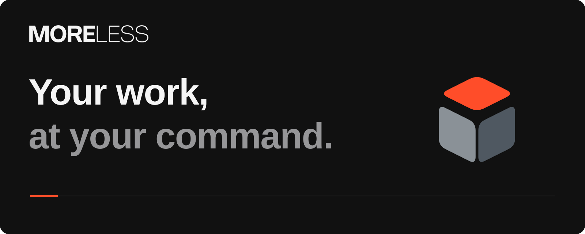
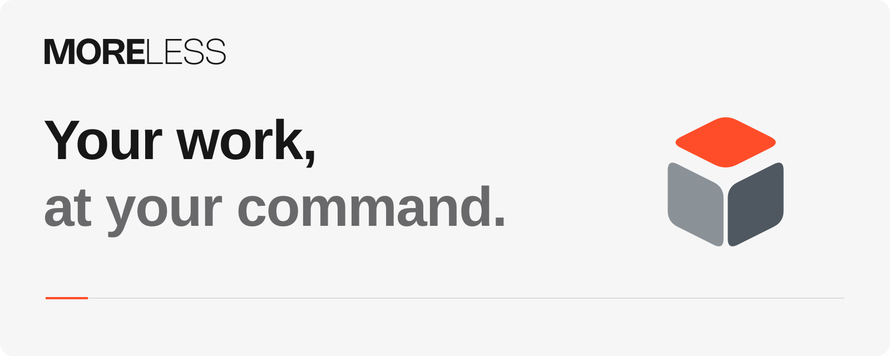

<a href="https://moreless.tools/en/#gh-dark-mode-only">
  <picture>
    <source media="(max-width: 600px)" srcset="https://raw.githubusercontent.com/moreless-tools/.github/main/moreless-cover-mobile-dark.svg">
    
  </picture>
</a>
<a href="https://moreless.tools/en/#gh-light-mode-only">
  <picture>
    <source media="(max-width: 600px)" srcset="https://raw.githubusercontent.com/moreless-tools/.github/main/moreless-cover-mobile-light.svg">
    
  </picture>
</a>

We're building MORELESS as one product for working with documents, images, text and code. A shared interface and command palette connect the tasks you do across different files.

Type a task or drop in a file and MORELESS offers a matching action. The palette also handles calculations, equations and unit or currency conversions as you type.

**[Open MORELESS](https://moreless.tools/en/)** · [Read the guides](https://moreless.tools/en/docs/) · [Suggest a feature](https://moreless.tools/en/feedback/)

### Inside MORELESS

| Work on | What you can do |
| --- | --- |
| [PDFs](https://moreless.tools/en/tools/pdf-editor/) | Edit supported PDF text, merge and split documents, organize pages, add annotations, fill forms and place a visible signature. |
| [Images](https://moreless.tools/en/tools/image-converter/) and [color](https://moreless.tools/en/tools/color-studio/) | Convert HEIC photos and other image formats, batch resize and crop, add watermarks, build palettes and gradients, and check contrast. |
| [Text and writing](https://moreless.tools/en/tools/word-counter/) | Count words, change case, compare text and find duplicate words. Write in the [notepad](https://moreless.tools/en/tools/online-notepad/) and export your notes. |
| [Code and data](https://moreless.tools/en/tools/json-formatter/) | Format, repair, compare and query JSON, validate schemas and generate TypeScript types. Convert CSV, encode or decode Base64, generate hashes and UUIDs, or preview HTML, CSS and JavaScript in the [code editor](https://moreless.tools/en/tools/code-editor/). |
| [QR codes](https://moreless.tools/en/tools/qr-code-generator/) and [barcodes](https://moreless.tools/en/tools/barcode-generator/) | Make static QR codes for links, Wi-Fi and contact details. Generate barcodes, import batches from CSV and export label sheets. |
| [Calculations and units](https://moreless.tools/en/tools/unit-converter/) | Convert units, calculate percentages and work out ages or date differences. The command palette also handles calculations, equations and currency conversions. |
| [Passwords](https://moreless.tools/en/tools/password-generator/) and [usernames](https://moreless.tools/en/tools/username-generator/) | Generate passwords, passphrases, PINs and usernames with the options you choose. |
| [Time and focus](https://moreless.tools/en/tools/online-timer/) | Run a timer, stopwatch, Pomodoro session, date countdown or interval sequence. Estimate a meeting's cost. |
| [GPS tracks](https://moreless.tools/en/tools/gpx-kml-converter/) | Convert GPX and KML files, merge tracks or split a track into segments. |
| [Networks](https://moreless.tools/en/tools/subnet-calculator/) | Calculate IPv4 and IPv6 subnets. |
| [Dice](https://moreless.tools/en/tools/dice-roller/) | Roll different dice and apply modifiers. |

### The PDF workspace

MORELESS brings editing, page organization and document preparation into a shared PDF editor, with page previews and undo/redo. We also develop our own PDF processing technology.

Compare two PDFs by text or appearance, redact content, compress a file, add watermarks and page numbers, crop margins or change page size. You can also manage passwords and permissions, edit metadata, flatten a document, attempt a repair, or turn photos of paper into a PDF.

Office conversions and OCR are in **beta**. Convert documents, spreadsheets and presentations to PDF, or export a PDF to Word, Excel, PowerPoint, text or page images. OCR adds a searchable text layer to scanned pages. Conversion results depend on the original file. Check the output before sharing it.

[Open the PDF editor](https://moreless.tools/en/tools/pdf-editor/) · [PDF guides](https://moreless.tools/en/docs/tools/pdf-editor/)

### MORELESS on the web

PDF, document, image and text processing happens on your device. MORELESS does not upload those files to its servers. Optional usage analytics require your consent. See the [privacy policy](https://moreless.tools/en/privacy-policy/) for details.

Favorites, saved presets and notepad drafts are stored in the same browser. Export anything you want to keep before clearing browser data.

The web product is free for personal and commercial use and works without an account. Use MORELESS on desktop, tablet or phone, in a light or dark theme. The interface and guides are available in English, Czech, German, French, Spanish, Hungarian and Brazilian Portuguese.

### MORELESS for Mac

MORELESS for Mac is **in development**. We're bringing the product into the menu bar, command palette and Finder, with a custom Dock, clipboard history and system tools.

[See the demos and join the alpha waitlist](https://moreless.tools/en/app/mac/).

### Talk with MORELESS

[Visit the feedback board](https://moreless.tools/en/feedback/) to suggest a feature, vote on requests or check known issues. To report a bug, choose **Report a problem** in the website footer. For security reports or anything that should stay private, email [hello@moreless.tools](mailto:hello@moreless.tools).

[Guides](https://moreless.tools/en/docs/) · [Troubleshooting](https://moreless.tools/en/docs/faq/troubleshooting/) · [Web updates](https://moreless.tools/en/changelog/web/) · [YouTube](https://www.youtube.com/@moreless_official)

[Reddit](https://www.reddit.com/r/moreless_official/) · [LinkedIn](https://www.linkedin.com/company/moreless-s-r-o/) · [Instagram](https://www.instagram.com/moreless_official/) · [Facebook](https://www.facebook.com/profile.php?id=61564026398953) · [X](https://x.com/moreless_it)

Made by **MORELESS s.r.o.** in Prague, Czech Republic.

[Contact MORELESS](https://moreless.tools/en/contact/) · [Privacy policy](https://moreless.tools/en/privacy-policy/) · [Third-party licenses](https://moreless.tools/en/legal/third-party-licenses/)
